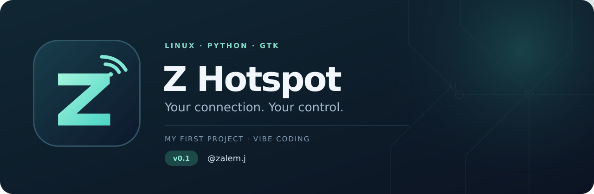

# Z Hotspot للينكس

**أول مشروع لي · Vibe Coding · v0.1**

اتصالك، وتحكمك.

هذا أول مشروع أنشره، بنيته بأسلوب Vibe Coding بمساعدة الذكاء الاصطناعي: برنامج لسطح مكتب لينكس لمشاركة الإنترنت، إدارة الأجهزة المتصلة، ونقل الملفات عبر الهوت سبوت. فيه واجهة صغيرة للتحكم السريع وواجهة كاملة بأربع صفحات. مبني باستخدام Python وGTK 3، والواجهة بالإنجليزية.

[English](README.md) · [تحميل البرنامج](https://github.com/zalemjb/z-hotspot/releases/latest) · [الإبلاغ عن مشكلة](https://github.com/zalemjb/z-hotspot/issues/new?template=bug_report.yml)

## المزايا

- تشغيل وإيقاف وتحديث الهوت سبوت، مع QR للانضمام للشبكة.
- عرض اسم الشبكة وعدد الأجهزة والإشارة وسرعة النقل من الإنترنت الأساسي وإلى أجهزة الهوت سبوت.
- تفاصيل الأجهزة: الاسم المعلن وIP وMAC والإشارة وسرعة النقل ومدة الاتصال، مع الفصل والحظر وإلغاء الحظر.
- مشاركة ملفات تختارها عبر رابط وQR، واستقبال ملفات في مجلد تحدده.
- تغيير اسم الشبكة وكلمة المرور، وتوليد كلمة مرور، واختيار مصدر الإنترنت، وإخفاء الشبكة وعزل الأجهزة.
- تشغيل بالخلفية مع أيقونة بجانب الساعة للرجوع للبرنامج والتحكم به.

## صور البرنامج

### الواجهة الكاملة — Full dashboard


### الواجهة الصغيرة — Compact dashboard


### مشاركة الملفات


الصور تستخدم بيانات تجريبية.

## التثبيت

### Debian وUbuntu وLinux Mint

حمّل **`z-hotspot_0.1.0_all.deb`** من [الإصدارات](https://github.com/zalemjb/z-hotspot/releases/latest)، وافتحه وثبّته بمدير الحزم. بعدها افتح **Z Hotspot** من قائمة البرامج، أو **Z Hotspot — Full view** للواجهة الكبيرة. الحزمة تثبّت الاعتماديات اللازمة. وملف **`Z-Hotspot-v0.1.zip`** في الإصدار نفسه يتيح تشغيل البرنامج من المصدر.

ويمكن تثبيته من الطرفية داخل مجلد التحميل:

```sh
sudo apt install ./z-hotspot_0.1.0_all.deb
```

### توزيعات لينكس الأخرى

حمّل **`Z-Hotspot-v0.1.zip`** من [الإصدارات](https://github.com/zalemjb/z-hotspot/releases/latest)، فك ضغطه، وثبّت الاعتماديات المكافئة من مدير حزم توزيعتك، ثم اتبع قسم **التشغيل من المصدر** أدناه. حزمة `.deb` مخصصة للتوزيعات المبنية على Debian.

اضغط **Unlock controls** للسماح بتعديل الشبكة. سيظهر طلب صلاحية المدير المعتاد من لينكس. الواجهة تعمل بحسابك العادي، وتعديلات الشبكة تنفّذها خدمة مساعدة بصلاحية المدير.

## متطلبات لينكس والواي فاي

- سطح مكتب لينكس مع Python **3.10 أو أحدث** وGTK 3/PyGObject ومكتبة QR ودعم عرض صور SVG.
- أدوات NetworkManager و`hostapd` و`dnsmasq` و`iw` و`iptables` و`ip` و`pkexec`.
- محول واي فاي يدعم وضع نقطة الوصول؛ استخدامه للاستقبال والبث معًا يحتاج دعم الاتصال المتزامن managed/AP.
- Ayatana AppIndicator وشريط أيقونات نظام يعمل لاستخدام وضع الخلفية.

عند استخدام محول واحد، اتصل أولًا بشبكة **2.4 GHz**؛ الهوت سبوت يستخدم القناة نفسها. تقدر تختار Ethernet كمصدر للإنترنت أيضًا. إذا بقي محول الواي فاي متصلًا بشبكة، يلزم أن يكون اتصاله على 2.4 GHz. هذا الإصدار يبث الهوت سبوت على 2.4 GHz.

البرنامج موجه للينكس، وتختلف أسماء الحزم ودعم المحولات وتكامل سطح المكتب بين التوزيعات. تفاصيل البيئات التي اختُبرت فعلًا وطريقة إضافة تقرير توافق موجودة في [TESTING.md](TESTING.md).

## الاستخدام

1. افتح البرنامج واضغط **Unlock controls**.
2. من **Network settings** اضبط اسم الشبكة وكلمة المرور ومصدر الإنترنت.
3. شغّل الهوت سبوت، ثم امسح **Join QR** بالجوال أو اتصل من إعدادات الواي فاي.
4. في **Full view** تجد الرئيسية، الأجهزة المتصلة، مشاركة الملفات، وإعدادات الشبكة.
5. اضغط **Background** لإبقاء البرنامج في الخلفية؛ تقدر تفتحه مجددًا من أيقونته بجانب الساعة.

الخروج من البرنامج يوقف مشاركة الملفات ويُبقي الهوت سبوت شغالًا. اضغط **Stop** قبل الخروج إذا تبي تطفئ الشبكة أيضًا. وضع الخلفية لا يضيف تشغيلًا تلقائيًا عند تسجيل الدخول، ولا يبدأ مشاركة الملفات بعد إعادة التشغيل.

## مشاركة الملفات مع الآيفون أو أندرويد أو لابتوب

1. وصّل الجهاز الآخر بالهوت سبوت.
2. افتح **Full view → Share files**، اختر الملفات، ثم اضغط **Start sharing**.
3. امسح **Transfer QR** بالجوال، أو افتح الرابط بمتصفح اللابتوب الآخر.
4. اضغط الملف ووافق على التنزيل. في الآيفون تلقاه في تنزيلات Safari أو **الملفات ← التنزيلات**. ولحفظ صورة أو فيديو في الصور، افتحه واستخدم قائمة المشاركة.
5. لاستقبال ملفات على الكمبيوتر، فعّل الاستقبال واختر مجلدًا، ثم ارفع الملفات من صفحة النقل على الجهاز الآخر.

الجهاز المستلم يختار التنزيل؛ البرنامج لا يحفظ ملفات في جوال آخر دون تفاعل منه. النقل محلي ولا يحتاج إنترنت بعد تشغيل الهوت سبوت. خلّ البرنامج مفتوحًا أثناء النقل.

تُشارك الملفات التي تختارها فقط، والاستقبال مغلق إلى أن تفعّله. الملفات المستلمة تُحفظ بأسماء غير مكررة ولا تستبدل ملفاتك الموجودة. الحد الأقصى للرفع **2 GiB لكل ملف**. رابط المشاركة يتغير مع كل جلسة؛ من يملك الرابط على شبكتك يقدر يصل للملفات المختارة. المشاركة المحلية تستخدم HTTP، فاستخدمها مع أشخاص تثق بهم على الهوت سبوت.

اختبارات النقل المحلية نجحت، بما فيها تطابق الملفات والنقل المتزامن ومحاكاة متصفحات Safari وChrome. **هذا لا يعني إجراء تجربة فعلية على آيفون أو سامسونج.** تفاصيل الاختبارات في [TESTING.md](TESTING.md).

## فهم القراءات

- سرعة الإنترنت الأساسي تشمل حركة الكمبيوتر والأجهزة المتصلة؛ هي سرعة نقل حالية وليست اختبار سرعة للباقة.
- Download وUpload للهوت سبوت محسوبة من جهة الأجهزة المتصلة.
- سرعة رابط الواي فاي سرعة تفاوضية، ونسبة الاستخدام تقديرية.
- اسم الجهاز مصدره DHCP، ولا يثبت هوية الشخص أو موديل الجوال. عنوان MAC الخاص أو العشوائي قد يجعل الجهاز يظهر كجهاز جديد.
- **Disconnect** يفصل الجهاز ويمكنه العودة؛ **Block** يمنع عنوان MAC الحالي إلى أن تلغي الحظر.

## التشغيل من المصدر

ثبّت الاعتماديات المذكورة أعلاه من مدير حزم توزيعتك؛ أو استخدم أمر التثبيت الخاص بـDebian وUbuntu وMint في [README الإنجليزي](README.md#run-from-source). أبقِ ملفات البرنامج والمساعد `create_ap` في المجلد نفسه، ثم شغّله من المجلد بعد فك الضغط:

```sh
python3 hotspot_gui.py
python3 hotspot_gui.py --full
python3 hotspot_gui.py --demo
```

الخيار `--demo` يعرض بيانات تجريبية دون تغيير الشبكة. لا تشغّل الواجهة كاملة باستخدام `sudo`؛ البرنامج يطلب الصلاحيات اللازمة عند الحاجة.

لإضافة البرنامج إلى قائمة التطبيقات بعد تثبيت الاعتماديات، شغّل:

```sh
python3 scripts/install_user.py --check
python3 scripts/install_user.py
```

المثبّت يفحص مكتبات Python وأدوات الشبكة المطلوبة، ثم ينسخ البرنامج إلى مجلد بيانات حسابك ويضيف اختصارات الواجهتين وخيار الخلفية. لا يحتاج `sudo`، ولا يثبّت حزم النظام أو يفعّل التشغيل التلقائي عند الدخول.

كود Z Hotspot الأصلي مرخّص [MIT](LICENSE). المساعد `create_ap` مرخّص BSD 2-Clause وتفاصيله محفوظة في [THIRD_PARTY_NOTICES.md](THIRD_PARTY_NOTICES.md). للمساهمة راجع [CONTRIBUTING.md](CONTRIBUTING.md)، وللمشكلات الأمنية [SECURITY.md](SECURITY.md).

صنعه **@zalem.j** · حساب GitHub: [@zalemjb](https://github.com/zalemjb)
